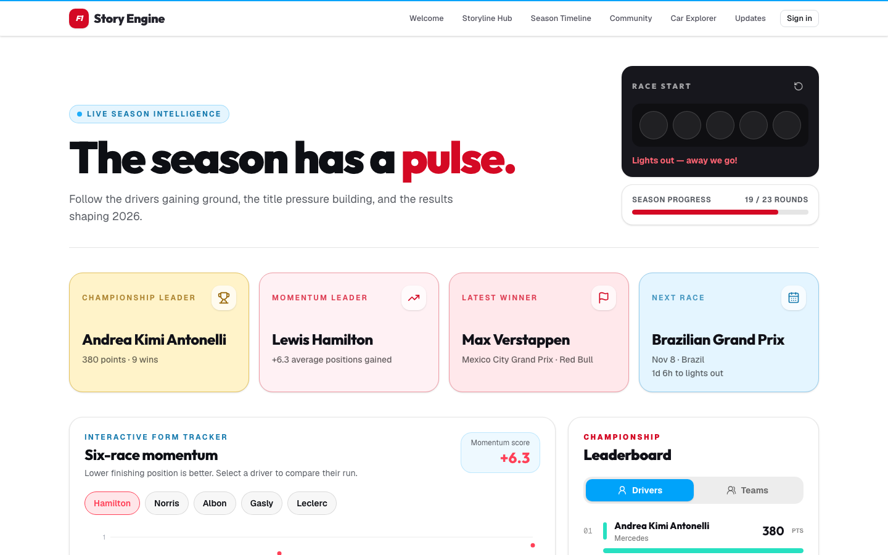
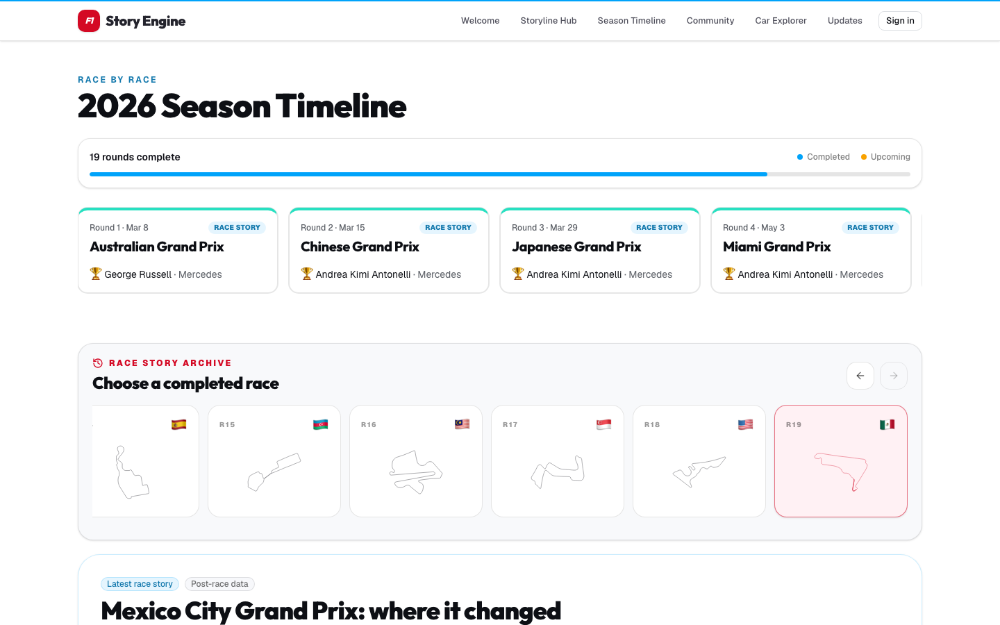

# F1 Story Engine

An interactive Formula 1 web app that connects **news → decisions → performance →
results**, so you can see _why_ a season is unfolding the way it is, not just who
finished where.

**Live site: [f1-story-engine.vercel.app](https://f1-story-engine.vercel.app)**



## What's inside

| Page | What it does |
| --- | --- |
| **Welcome** (`/`) | Landing page with a spinning 3D car and a tour of the product. |
| **Storyline Hub** (`/hub`) | Season dashboard: championship and momentum leaders, a six-race driver-form chart, switchable driver/team standings, a next-race countdown and the latest results. |
| **Season Timeline** (`/seasons/[year]`) | Every round of a season. Pick a completed race to open its **Race Story**: key Race Control moments, pit stops and podium tyre strategy. Each race tile shows its flag and an animated track outline. |
| **Car Explorer** (`/car-explorer`) | A rotatable 3D car with hotspots that explain the front wing, halo, sidepods, power unit, rear wing, floor and brakes. Also has a Tyre Lab and an Airflow Lab. |
| **Community** (`/community`) | A shared paddock: discussion posts, reactions and comments. Reading is public. Posting needs a magic-link email sign-in, and people choose an anonymous username. |
| **Updates** (`/updates`) | Latest F1 news headlines and Race Control messages in one feed. |



## Tech stack

- [Next.js](https://nextjs.org) 16 (App Router), React 19, TypeScript (strict)
- Tailwind CSS 4, shadcn/ui on Base UI primitives
- [Recharts](https://recharts.org) for charts; [react-three-fiber](https://r3f.docs.pmnd.rs) / drei / three.js for 3D
- [Supabase](https://supabase.com) (Auth + Postgres, Row Level Security) for Community
- Deployed on [Vercel](https://vercel.com). Everything runs on free tiers.

## Getting started

You need Node.js 20+ and npm.

```bash
git clone https://github.com/srujnil/f1-story-engine.git
cd f1-story-engine
npm install
npm run dev
```

Open [http://localhost:3000](http://localhost:3000). Race data works with no
configuration. Only **Community** (sign-in, posts, comments) needs Supabase.

### Environment variables

Copy `.env.example` to `.env.local`.

| Variable | Required | Purpose |
| --- | --- | --- |
| `NEXT_PUBLIC_SUPABASE_URL` | For Community | Your Supabase project URL (Settings → API). |
| `NEXT_PUBLIC_SUPABASE_ANON_KEY` | For Community | The anon or publishable key from the same page. |
| `F1_API_BASE_URL` | No | Defaults to the Jolpica F1 API. |
| `OPENF1_API_BASE_URL` | No | Defaults to the OpenF1 API. |

### Supabase setup (Community only)

1. Create a free Supabase project.
2. In the SQL Editor, run `supabase/schema.sql` once. It creates the tables,
   Row Level Security policies, rate limits, grants and starter posts.
3. Put the project URL and anon key in `.env.local`.

`supabase/migrations/` is only for databases created from an older version of
the schema. A fresh setup already includes everything, so skip it.

> Supabase's free plan pauses projects after about 7 days of inactivity. If
> Community stops working, restore the project from the Supabase dashboard.

### Scripts

| Command | What it does |
| --- | --- |
| `npm run dev` | Start the dev server. |
| `npm run build` | Production build. |
| `npm run lint` | Run ESLint. |
| `npm run format` | Format with Prettier. |

## How the data works

- **Race data** comes from the free [Jolpica F1 API](https://github.com/jolpica/jolpica-f1)
  (the maintained successor to Ergast). It is fetched server-side, paginated and
  cached for one hour. A race flips from "upcoming" to "completed" once results exist.
- **Race Control, pit stops and tyre stints** come from [OpenF1](https://openf1.org)
  historical data. If that enrichment is unavailable, the base timeline still works.
- **This is not a live timing screen.** The one-hour cache protects the free API
  limits, and Race Stories are post-race by design.
- **Track outlines and flags are automatic.** At build time,
  `scripts/generate-circuit-manifest.mjs` lists the SVGs in `public/circuits/`.
  Jolpica's `circuitId` is the file name, so a new circuit only needs its SVG
  added. Without one, the tile still shows the flag and country.
- Files in `data/mock-*.ts` are development fixtures and are not used by live routes.

## Project structure

```
app/          Routes (Next.js App Router)
components/   Shared React components
lib/          Data adapters (Jolpica, OpenF1, news, Supabase) and business logic
data/         Clearly labelled development fixtures
types/        Shared TypeScript types
supabase/     schema.sql and migrations (tables, RLS, rate limits, grants)
public/       Static assets: 3D model, circuit outlines, patterns
docs/         README screenshots
scripts/      Build-time helpers
```

More detail lives in [`SPEC.md`](./SPEC.md) (product scope) and
[`CLAUDE.md`](./CLAUDE.md) (conventions and a log of technical decisions).

## Credits and licenses

The code in this repository is released under the [MIT License](./LICENSE).
Third-party assets keep their own licenses:

- **Race data:** [Jolpica F1](https://github.com/jolpica/jolpica-f1) and
  [OpenF1](https://openf1.org).
- **3D car model:** "2026 F1 CAR EVO-1" by
  [Abu Saif](https://sketchfab.com/abuhossain844), licensed
  [CC BY 4.0](https://creativecommons.org/licenses/by/4.0/) via
  [Sketchfab](https://sketchfab.com/3d-models/2026-f1-car-evo-1-2208ef7bd3de4e25be25efa100f27501).
  It is a fan-made model, not a real team's technical design.
- **Circuit outlines:** [MasterPlay007/F1-Track-Layouts-SVG](https://github.com/MasterPlay007/F1-Track-Layouts-SVG)
  (CC0), plus two generated from [bacinger/f1-circuits](https://github.com/bacinger/f1-circuits)
  (MIT). See [`public/circuits/NOTICE.md`](./public/circuits/NOTICE.md).

## Disclaimer

F1 Story Engine is an unofficial fan project. It is not affiliated with, endorsed
by or connected to Formula 1, the FIA or any team or driver. F1, FORMULA ONE and
related marks are trademarks of their respective owners.
